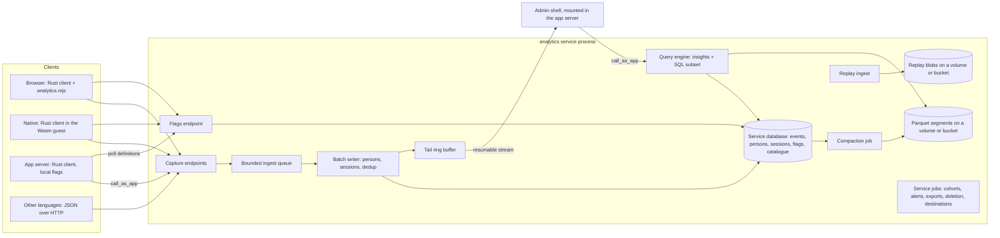

# The analytics service and the admin platform

Proposed 7 November 2026, against `main` at `7e8a7c7b`. This is the design, and the contract the implementation pull requests follow. The status of each part is in §21; decisions that are the owner's to make are in §22, each with the path taken until the owner says otherwise.

It builds on [services.md](services.md) (§9–§12 especially), [analytics-and-infra-plugins.md](analytics-and-infra-plugins.md) (the in-process route metrics that ship today), and [management-service.md](management-service.md) (the deployment console). The research behind the PostHog and Datadog comparisons is summarised in §2; the notes are in [analytics-research/](analytics-research/posthog.md).

**The goal.** Every leptoskit app can add one service, `analytics`, and get a self-hosted product-analytics platform at least as capable as PostHog: event capture, autocapture, identity, persons and groups, feature flags, experiments, session replay, surveys, heatmaps, web analytics, insights (trends, funnels, retention, paths, stickiness, lifecycle), cohorts, a safe SQL dialect, a Datadog-style live tail, error tracking, pipelines, alerts, LLM observability, and revenue analytics. Every app also gets an **admin platform**: one backend interface where people manage the app's services, see the state of its infrastructure, and use pages that each service contributes. Analytics is the first service to contribute pages; it is not special.

**The shape.** Analytics is a service plugin, exactly as `examples/analytics` is: a crate whose library holds the operations' types (which apps and clients compile) and whose `service` feature holds their bodies, storage, and binary (which only the service compiles). It runs in its own process with its own database, is reachable on the app's origin under `/_leptoskit/services/analytics/`, owns its jobs, and serves its own live socket. Nothing in this design needs a new kind of infrastructure for a small install: one SQLite file is enough. Larger installs move to Postgres, and the largest add a columnar tier on a volume or object storage (§7).

---

## 1. Goals, non-goals, and what "better than PostHog" means here

Goals:

- **Feature parity with PostHog's product surface** (the table in §19), with every client supporting every client-side feature: the web, native apps through the Wasm guest, server-side Rust, and plain HTTP.
- **One small process is enough.** A two-vCPU VM runs the app, the analytics service, and SQLite, and keeps up with a few thousand events per second (§6). PostHog's self-hosted "hobby" deployment needs 16 GB of RAM and ClickHouse, Kafka, Redis, Postgres, and several services, and PostHog no longer supports it.
- **The same code path scales.** The service's API, clients, and query engine don't change when storage moves from SQLite to Postgres to the columnar tier.
- **Privacy by default** (§17): no IP addresses stored, GPC honoured, masking on by default in replays, deletion and export as first-class operations.
- **An admin platform every install has** (§18), so app teams aren't left building their own back office.

Non-goals, for now:

- Hosting analytics for many unrelated customers. The schema keeps a `project` column so the hosted deployment service could later run one analytics service for several projects, but quotas, billing, and tenant isolation are out of scope.
- A data warehouse that imports from Stripe, Hubspot, and the rest. §15 covers the narrower part that matters to product analytics: revenue events, and joining the app's own data through its operations.
- Copying PostHog's code. Most of PostHog is MIT-licensed, but its `ee/` directory isn't, and the architecture is different anyway. This design ports behaviour, never source, and it doesn't copy PostHog's wire format either: §6 defines a smaller one.

Where leptoskit can do better than PostHog, and why it can:

| Area                       | PostHog                                                                                                         | Here                                                                                                                                                                                                                                    |
| -------------------------- | --------------------------------------------------------------------------------------------------------------- | --------------------------------------------------------------------------------------------------------------------------------------------------------------------------------------------------------------------------------------- |
| Self-hosting               | ClickHouse, Kafka, Redis, Postgres, object storage, and a dozen services; 16 GB minimum; officially unsupported | One binary and the app's own database engine; columnar storage is an opt-in tier on a volume or a bucket (§7)                                                                                                                           |
| Ad blockers                | Needs a reverse proxy the customer sets up                                                                      | Same origin by construction: `/_leptoskit/services/analytics/`, plus any `routes` prefix the app picks                                                                                                                                  |
| Typed events               | Free-form strings; a "data management" page tries to catch typos after the fact                                 | Apps can declare events as Rust types (§5), so a renamed property is a compile error, and the definitions feed the admin's event catalogue                                                                                              |
| Flags on the first paint   | Bootstrapping is manual; flicker is common                                                                      | The app's server evaluates flags locally while it renders and the page hydrates with them (§9); native apps start from the last cached set                                                                                              |
| Native session replay      | Screenshots or wireframes, with masking applied to pixels                                                       | leptoskit already sends every native screen as a stream of widget mutations (`leptoskit_native::backend::Mutation`); recording that stream is exact, small, and masks text before it leaves the device (§12)                            |
| Autocapture on native      | Limited to taps on platform views, named by class                                                               | Every component is leptoskit's own, so taps, presses, and form submissions carry the component's kind, label, and `test_id` on every platform (§14)                                                                                     |
| Live tail                  | An "activity" page that polls                                                                                   | A resumable stream with a server-side filter, sampling to a rate the viewer can read, and pause without losing place (§11), built on `#[rpc::stream(resumable)]`                                                                        |
| Live dashboards            | Cached insights refreshed on a timer                                                                            | Insights are live queries over the service's data with coalesced refresh (§10), so a dashboard updates as events arrive                                                                                                                 |
| Bytes on the wire          | JSON, with dozens of `$` properties (library, OS, browser, screen, URL, …) repeated in every event              | A binary batch format: what's the same for every event from a device is sent once per batch as a context, names are interned, a typed event sends no property names at all, and the batch is compressed (§6)                            |
| Bytes on disk              | Every event row repeats the same device and library properties                                                  | Contexts are stored once and referenced by id; event names and property keys are small integers from the catalogue (§7)                                                                                                                 |
| Admin                      | PostHog's app only covers PostHog                                                                               | An admin shell for the whole app: services, infrastructure, jobs, live connections, and each service's pages (§18)                                                                                                                      |
| Clients in other languages | A hand-written SDK per language                                                                                 | A JSON form of the capture and flags operations that any HTTP client can send, and `lk rpc generate`'s clients for TypeScript, Python, Dart, Go, and Rust (§16). An optional adapter accepts PostHog's formats for teams migrating (§6) |

---

## 2. What the research found

The full notes, with sources and how each claim was checked, are in [analytics-research/posthog.md](analytics-research/posthog.md) and [analytics-research/datadog-and-storage.md](analytics-research/datadog-and-storage.md); the points that shaped decisions are here.

**PostHog's product.** Beyond the list in the request, it now also has logs, workflows, endpoints, product tours, marketing analytics, and a cookieless mode. Product analytics (trends, funnels, retention, paths, stickiness, lifecycle, plus SQL insights), web analytics, session replay, feature flags, experiments, surveys, heatmaps, error tracking, a data warehouse, a CDP of transformations and destinations ("Hog functions"), LLM observability, revenue analytics, the toolbar, actions, cohorts, annotations, dashboards, notebooks, alerts, subscriptions, group analytics, early-access features, and data management (event and property definitions).

**PostHog's event model.** An event is `{event, distinct_id, properties, timestamp, uuid}`. Reserved `$`-prefixed events and properties carry the semantics: `$identify` (anonymous → identified, with `$anon_distinct_id`), `$create_alias`, `$set`/`$set_once`/`$unset` for person properties, `$groupidentify` and `$groups` for up to five group types, `$pageview`/`$pageleave`/`$autocapture`/`$exception`/`$feature_flag_called`/`$ai_generation`, and `$session_id`/`$window_id`/`$device_id`. Since 2024 PostHog processes person profiles only when asked (`person_profiles: 'identified_only'`), because most anonymous events never need one and person processing is its most expensive ingestion step.

**Merging.** Identifying an anonymous id merges it into the identified person once; merging two already-identified persons is refused (PostHog's "merge restrictions"), because doing it wrongly is the most common data-loss complaint. `alias` links a new id to an existing person under the same rules.

**Flags.** Rollouts hash `sha1("<flag_key>.<distinct_id><salt>")`, take the first 15 hex digits as an integer, and divide by `0xFFFFFFFFFFFFFFF` to get a number in [0, 1); a person is in the rollout when that's at most the percentage. Variants use the same hash with the salt `variant` and cumulative ranges, and holdouts hash `holdout-<value>`; holdouts and early-access enrolment are checked before release conditions. `/decide` has been replaced by `POST /flags?v=2`, and server SDKs poll `/flags/definitions` (formerly `/api/feature_flag/local_evaluation`) with ETags and evaluate locally, falling back to the server for what they can't evaluate (static and behavioural cohorts, `is_not_set`, experience continuity, early-access flags). §9 keeps the algorithm bit-for-bit, so a migrated rollout keeps every person in the same bucket.

**Experiments.** PostHog's original engine was Bayesian (beta-binomial for conversions, gamma-Poisson for counts, Monte Carlo "probability to be best", expected loss). Its current engines are a Gaussian Bayesian one and Welch's t-test with optional sequential testing, with CUPED (a 14-day pre-exposure window by default) and a chi-squared sample-ratio-mismatch check flagged at p < 0.001. §13 specifies ours.

**Ingestion.** PostHog's capture service (Rust) accepts `/e`, `/batch`, `/i/v0/e`, and `/capture`, gzip or lz64-compressed, corrects clock skew from `sent_at` (clamping events more than 23 hours in the future to now), answers `200` even when it drops events, and writes to Kafka partitioned by `token:distinct_id`; Node ingestion workers process persons and plugins and write to ClickHouse. Overflow topics isolate hot `distinct_id`s, which then get no person updates. PostHog is moving ingestion, persons, and deduplication to Rust services, and computes funnels with a Rust function inside ClickHouse. The design avoids Kafka by making one process the writer per database and using the database itself as the durable queue (§6).

**Replay.** rrweb records a full DOM snapshot and incremental mutations; PostHog sends them in `$snapshot` batches to `/s` and stores Snappy-compressed blocks per session in batched object-storage files, read back by byte range, with masking of inputs on by default. Its mobile replay defaults to wireframes. OpenReplay (zstd files) and Highlight (Brotli chunks) also keep replay out of the analytics store.

**HogQL** is ClickHouse's grammar cut down to `SELECT`; the printer adds the team filter to every table it reads; queries run read-only with a 60 s timeout, 100 rows by default and 50,000 at most. A December 2025 remote-code-execution chain went through its ClickHouse string escaping, which is why §10 never builds SQL by concatenating strings.

**What users complain about.** Pricing surprises at volume (flag requests, including local-evaluation polls, are metered); self-hosting being hard and then unsupported (the hobby deploy pulls `master`, runs about 30 containers, and is rated for about 100,000 events a month); no way to expire events (issue #17031, open since 2023); ClickHouse operations; slow queries on big projects; ad blockers; flag latency and flicker without bootstrapping; person merges going wrong (generic ids like `null` merging strangers, forgetting `reset()` on sign-out, `$set` applied in arrival order rather than event time); replay storage cost; and events silently dropped by quota limits. Each one maps to a decision: one-process installs, same-origin capture, bootstrapped flags, merge restrictions with an audit trail, replay retention per project, and visible drops (every drop is counted and shown, §6).

**Datadog.** Live Tail shows every log after processing and before indexing, so logs excluded from indexing still appear, with a faceted query (`service:web @http.status:>=500 -env:dev`) and uniform random sampling when the stream is heavy. Datadog doesn't document its rate cap or buffer size. "Logging without limits" separates ingesting from indexing: exclusion filters, sampling rules, and metrics generated from the stream decide what's kept. RUM models a session of views, actions, resources, errors, and long tasks, ending after 15 minutes of inactivity or 4 hours in total, with frustration signals (a rage click is more than three clicks within a second; dead clicks; error clicks) and Core Web Vitals. Its browser SDK flushes every 30 s, 50 events, or 16 KiB; its mobile SDKs batch up to 1,000 events or 5 MB, keep at most 512 MB on disk, and drop batches older than 18 hours. §11 adopts the query syntax, the ingest-versus-keep split, and the frustration signals; §8 adopts the session limits.

**Columnar storage.** Covered in §7: ClickHouse is the fastest and the hardest to run, DuckDB is fast and embedded but a C++ build and a single writer, and Parquet with Apache DataFusion is pure Rust and needs the compaction and catalogue we write ourselves.

---

## 3. Naming and crates

**Decision: split by layer, and give the service the name.** `leptoskit_analytics` becomes the service plugin. The per-process route observability that the crate holds today (minute aggregates, `traceparent`, `/_leptoskit/analytics.mjs`, OTLP export) moves, with its history, to a new crate, **`leptoskit_apm`**. The service then ingests what `leptoskit_apm` exports, so the admin shows application performance next to product analytics: the route metrics are folded in as the service's APM and RUM part, without the two crates depending on each other.

Why not evolve the crate in place:

- **A dependency cycle.** `leptoskit_axum` depends on today's crate to mount the collector in every app, while a service plugin's binary depends on `leptoskit_axum::service`. Cargo refuses the cycle even when both edges are optional.
- **Different lifetimes.** The route metrics are bounded, in memory, and inside the app's process, so they work with no extra service at all, which is their point (see [analytics-and-infra-plugins.md](analytics-and-infra-plugins.md)). The service is durable and separate. One crate would force apps that want only the cheap part to compile the service's types, or the reverse.
- **The facade's feature name.** `leptoskit`'s `analytics` feature should mean what an app author expects: capture, identify, and flags. Today it means route metrics.

What changes for existing users:

| Today                                                   | After the split                                                                                                                           |
| ------------------------------------------------------- | ----------------------------------------------------------------------------------------------------------------------------------------- |
| `leptoskit_analytics::{Analytics, Evidence, …}`         | `leptoskit_apm::{…}`, the same items                                                                                                      |
| `leptoskit` feature `analytics` (route metrics)         | feature `apm`. `analytics` keeps implying `apm` for one release, with a changeset saying so, then means only the product-analytics client |
| `leptoskit_axum` feature `analytics`                    | feature `apm`                                                                                                                             |
| `/_leptoskit/analytics` and `/_leptoskit/analytics.mjs` | unchanged paths, served by `leptoskit_apm`                                                                                                |
| `[infra.plugins.analytics]`, `lk infra analytics`       | unchanged for now: renaming a configuration key is a schema change for little gain. §22 records it as an owner decision                   |

The crates, when the plan in §20 is complete:

| Crate                     | What it is                                                                                                                                                                                                                                                                                                                                                                                                                                                                                               |
| ------------------------- | -------------------------------------------------------------------------------------------------------------------------------------------------------------------------------------------------------------------------------------------------------------------------------------------------------------------------------------------------------------------------------------------------------------------------------------------------------------------------------------------------------- |
| `leptoskit_analytics`     | The service plugin. With no features: the event model, the wire format's encoder, the operations' types (with `service = "analytics"`), and the client (§16), with no dependency an app doesn't already have (§16, size and speed). `server-client`: the flag evaluator and local evaluation for the app's server. `service`: ingestion, storage, the query engine, jobs, and the binary. `columnar` and `posthog` add to `service`. Re-exported by the facade's `analytics` feature (client side only). |
| `leptoskit_analytics_web` | Not a crate: the browser module's parts (autocapture, replay with rrweb, heatmaps, surveys, the toolbar) live in `leptoskit_analytics/web/` as separate files the service serves, each loaded only when the page needs it (§16). Rust in the browser uses the library's client directly.                                                                                                                                                                                                                 |
| `leptoskit_apm`           | Today's route metrics, moved.                                                                                                                                                                                                                                                                                                                                                                                                                                                                            |
| `leptoskit_admin`         | The admin shell (§18): layout, navigation, the sign-in gate, the widget set, the page-document format, and the Axum mount.                                                                                                                                                                                                                                                                                                                                                                               |

The columnar tier (§7) is a feature of `leptoskit_analytics`, `columnar`, off by default, because DataFusion is a large dependency. If its build time hurts the workspace's CI, it moves to its own crate behind the same feature name.

`examples/analytics` becomes the example _of using_ the plugin: `analytics_app` declares `[services.analytics] crate = "leptoskit_analytics"` (a `path` in the workspace), and `analytics_service`, the hand-written reference service, is kept as the minimal "write your own service" example the services guide walks through, renamed `examples/services` when the guide moves to it. Until then both stay, and `examples/analytics/readme.md` says which is which.

---

## 4. Architecture



Every box inside the service runs in one process for a small install. For a larger one on Postgres, several replicas run behind the edge; each replica runs its own ingest queue and writer, and the database serialises what must be serialised (§6, §8).

The service follows the [services contract](services.md#4-the-runtime-contract) unchanged: `database = true`, `public = true`, volumes `replay` and `segments` (§7, §12), `leptoskit_axum::service::main!`, service-owned jobs and cron, and its own live socket.

---

## 5. The event model

An event, as stored and as every API returns it:

| Field         | Type                  | Notes                                                                                                                                                                         |
| ------------- | --------------------- | ----------------------------------------------------------------------------------------------------------------------------------------------------------------------------- |
| `uuid`        | UUID v7               | Made by the client, so a retried send is recognised (§6). Made by the service when absent.                                                                                    |
| `event`       | string, 1–200 bytes   | `$`-prefixed names are reserved for the semantics below.                                                                                                                      |
| `distinct_id` | string, 1–200 bytes   | The id the client knows the person by.                                                                                                                                        |
| `person_id`   | UUID, nullable        | Filled at ingestion (§8). Null for events without person processing.                                                                                                          |
| `timestamp`   | UTC, microseconds     | When it happened, corrected for the client's clock skew (§6).                                                                                                                 |
| `received_at` | UTC, microseconds     | When the service accepted it.                                                                                                                                                 |
| `session_id`  | UUID v7, nullable     | `$session_id`, promoted to a column because sessions, replay, and web analytics all key on it.                                                                                |
| `context_id`  | integer               | The context the event was sent with (below).                                                                                                                                  |
| `properties`  | JSON object           | Up to 64 KiB encoded by default (`max_properties_bytes`, at most 1 MiB).                                                                                                      |
| `groups`      | up to 5 `(type, key)` | From `$groups`.                                                                                                                                                               |
| `source`      | small enum            | `web`, `ios`, `android`, `macos`, `windows`, `linux`, `server`, `http`, `import`: which client sent it, from the endpoint and the key, never from a property the sender sets. |
| `project`     | small integer         | Always 1 today (§1).                                                                                                                                                          |

The reserved events and properties take PostHog's names where one exists, because people know them; nothing depends on matching PostHog beyond the optional adapter (§6): `$identify`, `$create_alias`, `$set`, `$set_once`, `$unset`, `$groupidentify`, `$groups`, `$pageview`, `$pageleave`, `$screen`, `$autocapture`, `$exception`, `$feature_flag_called`, `$survey_shown`/`$survey_sent`/`$survey_dismissed`, `$ai_generation`/`$ai_span`/`$ai_trace`, `$web_vitals`, `$snapshot`, `$session_id`, `$window_id`, `$device_id`, `$current_url`, `$referrer`, `$browser`, `$os`, `$lib`, `$lib_version`, and the `utm_*` and click-id properties. leptoskit's own additions use the `$lk_` prefix: `$lk_component` (autocapture's component kind), `$lk_test_id`, `$lk_route` (the route template, not the URL), and `$lk_release` (the code-push release a native app runs).

**Contexts.** Most of what PostHog repeats in every event describes the device and the library, not the event: `$lib`, `$lib_version`, `$os`, `$os_version`, `$browser`, `$device_type`, the screen and viewport size, locale, time zone, app version, `$lk_release`, `$device_id`, and the source. Here those are a **context**: a client sends each context once per batch and every event points at it, and the service stores each distinct context once (by a hash of its contents) in a `contexts` table. Queries see context fields as if they were event properties (`properties.$os` works), so nothing about filtering changes; only the bytes do. A context changes when one of its fields does (an app update, a rotated screen), which is rare next to the number of events.

**Typed events.** An app can declare its events as Rust types:

```rust
#[derive(analytics::Event, Serialize)]
#[event(name = "checkout_completed")]
pub struct CheckoutCompleted {
	pub plan: Plan,
	pub amount_cents: u64,
}

analytics::capture(CheckoutCompleted { plan, amount_cents });
```

The derive gives the event a name, a JSON Schema, and a schema id (a hash of the name and the fields' names and types); on the wire, a typed event sends the schema id and its values in field order, with no property names (§6). `lk build` collects the schemas (as `lk rpc` collects operations) into the service's event catalogue, so the admin knows every event and property before the first one arrives, flags misspelled ones (events with no definition), and can refuse unknown properties per event when the app asks it to. Untyped `capture("name", props)` stays available everywhere.

---

## 6. Ingestion at scale

### Endpoints

Under `/_leptoskit/services/analytics/` (and any `routes` prefix the app adds, such as `/_a`):

| Path                                          | Body                                                                   | For                                                              |
| --------------------------------------------- | ---------------------------------------------------------------------- | ---------------------------------------------------------------- |
| `v1/batch`                                    | the binary batch format (below)                                        | The Rust client on every platform, including `sendBeacon`        |
| `api/capture` (the typed operation)           | JSON: `{ batch: [Event], sent_at }`                                    | Generated clients, other languages, and curl                     |
| `v1/flags`, `v1/flags/definitions`            | §9                                                                     | Clients that evaluate remotely, and the app server's local copy  |
| `v1/replay`                                   | replay chunks (§12)                                                    | Recorders                                                        |
| `otlp/v1/metrics`                             | OTLP/HTTP JSON                                                         | `leptoskit_apm`'s exporter, so route metrics land in the service |
| `posthog/e`, `posthog/batch`, `posthog/flags` | PostHog's JSON formats, gzip or lz64 (only with the `posthog` feature) | Teams moving from PostHog who keep its SDKs for a while          |

The project key (`lkpk_…`, public, one per source so each can be rotated) identifies the project when a request doesn't come from the app's own origin. The typed operation and `v1/batch` on the app's own origin need none.

### The wire format

PostHog's format is JSON, one object per event, and every event carries the library's and the device's properties again. posthog-js's `getEventProperties` alone adds 24 `$` properties to every event (library, browser, OS, screen and viewport sizes, URL, language, time zone, the raw user agent, …), and its core adds the session, window, referrer, and persisted properties on top; most are the same in every event a browser sends. gzip recovers part of that, but the service still parses and stores all of it. Nothing here needs to stay compatible with it, so the clients send a format made for the job:

- **One batch, binary.** A batch is a small format of its own, specified in `leptoskit_analytics::wire`: LEB128 integers, length-prefixed strings, and a tag byte per value, with a version byte after the `LKE` magic. The client and the service share the one encoder and decoder, which depend on nothing, so an app pays for neither serde nor a format crate; a byte snapshot test pins the encoding.
- **Contexts once.** The batch starts with the contexts its events use (§5), each with a small index; an event carries the index, not the fields.
- **Strings once.** Event names and property keys go in a string table at the start of the batch; events refer to them by index. Reserved names (`$pageview`, `$set`, `$current_url`, …) have fixed codes and aren't sent at all.
- **Typed events by position.** An event declared with `#[derive(analytics::Event)]` sends its schema id and its values in field order. The service knows the schema from the event catalogue, which `lk build` fills; a schema id it doesn't know yet is refused with a reason, and the client resends that event in the keyed form.
- **Typed values.** Integers, floats, booleans, strings, timestamps, lists, and maps are encoded as what they are, not as JSON text, so `amount_cents: 1999` is three bytes, and a property's type is known on arrival rather than guessed.
- **The timestamp is in the id.** Every event's UUID v7 is made when the event happens, and its first 48 bits are that time in milliseconds, so the event doesn't send a separate timestamp. The batch sends `sent_at` once, for clock correction.
- **Identity changes are operations.** `$set`, `$set_once`, `$unset`, `$identify`, `$create_alias`, and `$groupidentify` are their own kinds in the batch rather than events with magic properties, so the writer doesn't search properties for them.
- **Compression by the platform, never in the client's code.** The browser compresses with its built-in `CompressionStream` (gzip). Native apps hand the encoded batch to the host with a `gzip` flag on `leptoskit_plugin_http`'s request, and the host compresses with the system's zlib (Apple's `libz`, Android's `Deflater`) or `miniz_oxide` on the Rust backends; the guest runs in an interpreter, where compressing would be slow and a compressor would add to every code-push download. The app's server sends to the service's private URL uncompressed, which costs no CPU on the request path. A zstd dictionary was considered and dropped: no browser, Apple, or Android API offers zstd compression, so it would mean bundling an encoder, and once contexts and names are sent once, little repetition is left for a dictionary to remove.
- **Small answers.** The answer to a batch is the indexes of refused events with a reason code each, or nothing.

Step 1 measures bytes per event against an equivalent posthog-js batch, for a pageview, a click, and a typed event, and records the figures in §21. The target is under 100 bytes per typical event after compression.

**JSON for everyone else.** `api/capture` takes the same batch as JSON, with names in full and timestamps as RFC 3339, for clients in other languages and for curl. It's the typed operation, so `lk rpc generate` gives every supported language a client.

**PostHog's formats** are an adapter behind the `posthog` feature, off by default: it translates PostHog's capture and flags requests into the same pipeline, for teams who want to point existing PostHog SDKs at the service while they move. It's a migration aid, not a constraint: nothing else in the design follows PostHog's wire format, and the adapter comes last in the plan (§20).

### The pipeline

```text
request ──► decode + validate ──► ingest queue (bounded) ──► batch writer ──► commit ──► ack
                 │                       │ full                   │
                 ▼                       ▼                        ▼
             400 + reason            503 Retry-After          tail ring buffer, live feeds
```

1. **Decode and validate** on the request's task: decompress with a hard ceiling (16 MiB decompressed, so a small compressed bomb can't expand without limit), decode, resolve contexts and interned names, check sizes and names, reject what's invalid with a reason per event. A batch with some invalid events stores the valid ones and returns which were refused.
2. **Correct the clock.** With `sent_at`, `timestamp = client_timestamp - (sent_at - received_at)`, as PostHog does, so a phone whose clock is an hour off records events at the right time. Events more than 23 hours in the future are clamped to `received_at` and marked `$lk_clock_clamped`.
3. **Enqueue** into one bounded queue per process, measured in events and in bytes (default 50,000 events or 64 MiB, whichever comes first). The queue is the only buffer, so memory is bounded by configuration, not by load.
4. **Batch writer.** One task drains the queue in batches (up to 2,000 events or 50 ms, whichever comes first), runs person and session processing for the batch (§8), and writes the batch in one transaction: one multi-row `INSERT` per table on SQLite, `COPY` on Postgres.
5. **Ack after commit (group commit).** The request's handler waits until the batch holding its events commits, then answers `200`. Many concurrent requests share each commit, so throughput comes from batching while every `200` means the events are durable. An app that prefers latency over durability sets `LEPTOSKIT_ANALYTICS_ACK=queued` on the service (`IngestConfig::ack`), which answers as soon as the events are enqueued and accepts losing at most the queue on a crash; duplicates aren't known by then, so none are reported.

**Idempotency.** `uuid` is unique per project. The writer inserts with `ON CONFLICT (project, uuid) DO NOTHING`, so a client that retries after a lost response records the event once. Clients make a UUID v7 for each event when it's created, never when it's sent (it also carries the event's time, above). In the columnar tier, the hot table keeps uniqueness for its window (48 hours by default) and compaction drops duplicates within each partition, so a retry older than the hot window could be stored twice; clients give up retrying well within it (§16).

**Backpressure.** When the queue is full, capture answers `503` with `Retry-After`, and every client backs off and keeps the events in its own queue (§16). The service never drops an accepted event silently, and, unlike PostHog's capture, it never answers `200` for events it dropped. Every refusal is counted by reason (`invalid`, `too_large`, `queue_full`, `rate_limited`, `consent`) in an `ingestion_warnings` table, and the admin's ingestion page shows the counts, as PostHog's "ingestion warnings" do.

**Rate limits.** Per project key and per IP, token buckets in memory (per replica), with defaults well above a real client's rate, to bound a single abusive sender. A hot `distinct_id` (a load test, a bot) gets its own lower bucket so it can't starve the writer, which plays the part of PostHog's overflow topic.

**Targets.** To be measured in the first implementation pull request and recorded in §21, on a 2 vCPU, 4 GB VM:

| Storage                   | Sustained, with person processing                  | Bursts (absorbed by the queue) |
| ------------------------- | -------------------------------------------------- | ------------------------------ |
| SQLite (WAL, one writer)  | 5,000 events/s                                     | 20,000 events/s for 60 s       |
| Postgres (same host)      | 5,000 events/s per replica, 15,000 across replicas | as above, per replica          |
| Columnar tier on Postgres | 30,000 events/s across replicas                    |                                |

Published batched-insert figures are far higher for narrow rows (SQLite in WAL mode, 300,000 rows a second and more in batches of thousands; Postgres `COPY`, 200,000 and more), so these targets leave room for JSON properties, indexes, and person processing. 5,000 events per second is about 13 billion events a month, which is more than most apps that would self-host need; the point of the targets is that a small install is never the bottleneck. Replay chunks (§12) are written to blobs, not rows, so they don't count against these.

---

## 7. Storage

### Small and medium installs: the service's own database

The service's database (SQLite or Postgres, per [services.md §3](services.md#3-the-service-manifest-and-its-data)) holds everything by default:

| Table                                                                                                                                           | Holds                                                                                                                                                                                                                                                                                                                                                       |
| ----------------------------------------------------------------------------------------------------------------------------------------------- | ----------------------------------------------------------------------------------------------------------------------------------------------------------------------------------------------------------------------------------------------------------------------------------------------------------------------------------------------------------- |
| `events`                                                                                                                                        | §5. `uuid` (the key), `person_id`, and `session_id` as UUIDs, which SQLite stores as 16-byte blobs; `event` as text; `context_id`. Indexes on `timestamp`, `(event, timestamp)`, `(distinct_id, timestamp)`, and `session_id`. Later: event names as small integers from `event_definitions`, and on Postgres, partitions by month with BRIN on `timestamp` |
| `contexts`                                                                                                                                      | Each distinct context (§5) once, keyed by a hash of its fields                                                                                                                                                                                                                                                                                              |
| `persons`, `person_distinct_ids`, `person_overrides`                                                                                            | §8                                                                                                                                                                                                                                                                                                                                                          |
| `groups`                                                                                                                                        | §8                                                                                                                                                                                                                                                                                                                                                          |
| `sessions`                                                                                                                                      | One row per session, maintained by the writer (§8)                                                                                                                                                                                                                                                                                                          |
| `event_definitions`, `property_definitions`                                                                                                     | The catalogue: every event and property seen or declared, with types, first and last seen, and volume                                                                                                                                                                                                                                                       |
| `daily_rollups`                                                                                                                                 | Counts per `(day, event)` and distinct persons per `(day, event)` as HyperLogLog sketches, so long-range trends never scan raw events                                                                                                                                                                                                                       |
| `flags`, `experiments`, `surveys`, `cohorts`, `cohort_members`, `actions`, `insights`, `dashboards`, `annotations`, `alerts`, `destinations`, … | The product's own objects, ordinary `#[table]`s, live where screens watch them                                                                                                                                                                                                                                                                              |
| `segments`, `tombstones`                                                                                                                        | The columnar tier's catalogue (below)                                                                                                                                                                                                                                                                                                                       |

Properties are a JSON text column holding only the event's own properties, since the device's are in its context; moving them to SQLite's and Postgres's binary `jsonb` is a measured follow-up. Autocapture's element chains will be interned the same way as contexts, in an `elements` table. The bytes per stored event are recorded in §21.

This is enough for most apps. SQLite on a volume handles tens of millions of events with the indexes and rollups above; Postgres handles hundreds of millions.

### Large installs: a columnar tier

**Decision: Parquet segments on a volume or object storage, queried with Apache DataFusion, with the service's database as the catalogue and the hot tier.** Turned on with `storage = "columnar"` (and the `columnar` feature). The options weighed:

| Option                   | For                                                                                                                                                                                                                                | Against                                                                                                                                                                                                                                                                                                                                                                                                            |
| ------------------------ | ---------------------------------------------------------------------------------------------------------------------------------------------------------------------------------------------------------------------------------- | ------------------------------------------------------------------------------------------------------------------------------------------------------------------------------------------------------------------------------------------------------------------------------------------------------------------------------------------------------------------------------------------------------------------ |
| **ClickHouse**           | The fastest (about 2 million narrow rows a second into one node); what PostHog uses; mature `MergeTree` engines for exactly this data                                                                                              | Another server to run, back up, and upgrade; ClickHouse recommends 32 GB of RAM and more, and replication needs Keeper. PostHog itself moved its warehouse off ClickHouse, citing the lack of a cost-based optimiser and results changing between versions. Services can't declare containers ([services.md §3](services.md#other-resources)), so it would be a remote dependency every install configures by hand |
| **DuckDB** (2.0, MIT)    | Embedded, very fast, reads and writes Parquet; DuckLake 1.0 is the same Parquet-plus-SQL-catalogue design as below, and PostHog rebuilt its warehouse on DuckDB in 2026                                                            | A bundled C++ build (compile time and binary size in every CI job that builds the service, and harder cross-compiling; S3 and time zones need extensions the bundled crate leaves out); only one process can write a database, which conflicts with Postgres installs running several replicas; DuckLake exists only inside DuckDB                                                                                 |
| **Parquet + DataFusion** | Pure Rust, built by cargo like everything else; no server; storage on a volume or any S3-compatible bucket, at object-storage prices; any number of replicas can read; DataFusion speaks SQL, which the query engine already emits | We write the ingestion into segments, the compaction, and the catalogue; latency on cold, unpartitioned scans is higher than ClickHouse's                                                                                                                                                                                                                                                                          |
| **Postgres extensions**  | No new storage                                                                                                                                                                                                                     | Each needs a custom Postgres build or image, which `lk infra` and most managed providers don't give. TimescaleDB's compression is under the Tiger Data licence; Citus and Hydra's columnar storage are AGPL, and Hydra looks unmaintained; ParadeDB archived `pg_analytics` in 2025; `pg_duckdb` 1.0 (MIT) is the healthy one, with DuckDB's build costs inside Postgres                                           |

Parquet with DataFusion fits the services model: the service still owns its data, needs no other process, and scales storage by pointing at a bucket. DataFusion led ClickBench (about 100 million rows) for single-node queries over Parquet, and InfluxDB 3, GreptimeDB, OpenObserve, and Parseable are built the same way. The work it needs is bounded and is what DuckLake does: a SQL database as the catalogue of immutable files. delta-rs and iceberg-rust were considered for the table format and not used: our catalogue is one small table in a database the service already has, and iceberg-rust still leaves compaction to the caller.

How it works:

- **Hot tier.** New events land in the `events` table as before. It keeps the last 48 hours (`hot_hours`).
- **Segments.** A service-owned cron job compacts closed hours into Parquet files partitioned by `project/day/hour`, sorted by `(event, person_id, timestamp)`, with zstd compression and row groups of 128k rows, written to the `segments` volume or to `object_store` (S3, R2, GCS, Azure, or a directory). Each file is registered in the `segments` table in the same transaction that marks its hour compacted. The job is claimed through the jobs table, so with several replicas exactly one compacts each hour.
- **Queries** run in DataFusion over a table that unions the segments the catalogue lists (pruned by partition and by Parquet statistics) with the hot rows the database returns as Arrow batches for the hours not yet compacted.
- **Persons and other mutable objects** stay in the database. The query engine joins them in DataFusion through a table provider over the database, so a person's current properties are always current, without rewriting segments.
- **Deletion.** A person's deletion (§17) writes a tombstone; queries filter tombstoned persons at once, and a job rewrites the affected segments and removes the tombstone when done.
- **Later:** a ClickHouse adapter behind the same query interface, for installs that already run ClickHouse. The engine's planner emits SQL per backend (§10), so ClickHouse is a dialect, not a redesign.

### Replay and other blobs

Replay chunks (§12), exports, and uploaded source maps go to the `replay` and `exports` volumes, or to the same `object_store` bucket under their own prefixes. The database keeps an index row per chunk.

---

## 8. Persons, groups, and sessions

**Persons.** A person has a UUID, properties, `created_at`, `is_identified`, and one or more distinct ids. Person processing, run by the batch writer for each batch in order:

- An event whose `distinct_id` is unknown creates a person, unless person processing is off for it. `person_profiles = "identified_only"` (the default, as PostHog's is) creates persons only for identified ids and for events that set person properties; other anonymous events keep `person_id` null and still count by `distinct_id`.
- `$set`, `$set_once`, and `$unset` update properties, last write wins by event timestamp per property, so out-of-order arrival converges. PostHog applies them in arrival order, so an offline phone's old events can overwrite newer properties; this is a deliberate difference.
- Distinct ids that are generic placeholders (`null`, `undefined`, `anonymous`, `0`, `guest`, the empty string, and PostHog's list) never create or merge persons.
- `$identify` with `$anon_distinct_id`: when the anonymous id's person isn't identified, its distinct ids move to the identified person and an override `old → new` is recorded. When both are identified, the merge is refused and recorded as an ingestion warning (`merge_refused`), as PostHog's merge restrictions do.
- `$create_alias` follows the same rules.
- Events keep the `person_id` they were written with. Queries map it through `person_overrides`, so a merge applies to past events at once without rewriting them, and a nightly job squashes overrides into the events table (and into segments at compaction).

On Postgres with several replicas, two replicas can process the same distinct id at the same time. Person rows are written with `INSERT … ON CONFLICT` and properties merged per key in SQL, and merges take an advisory lock on the person pair, so the result doesn't depend on which replica wins.

**Groups.** Up to five group types per project (`company`, `team`, …), each with keys and properties, set with `$groupidentify` and attached to events through `$groups`. Every insight can count unique groups instead of persons.

**Sessions.** Clients make the session id (UUID v7) and rotate it after 30 minutes without activity or 24 hours in total (PostHog's limits; Datadog's RUM uses 15 minutes and 4 hours, and both are settings). The writer upserts one `sessions` row per session: first and last timestamp, duration, entry and exit URL and route, event and pageview counts, bounce, channel (from referrer and UTM, with PostHog's channel rules), and whether a replay exists. Web analytics (§14) reads sessions, not events.

---

## 9. Feature flags

**Definitions.** A flag has a key, an active switch, release conditions (groups of property filters on person, group, or cohort, each with a rollout percentage and an optional variant override), optional variants with rollout shares, optional JSON payloads per variant, `aggregation` (persons or a group type), and `ensure_experience_continuity`. Flags can depend on other flags. Early-access features are flags with a description that people opt into.

**Evaluation** lives in the library, `leptoskit_analytics::flags` (the `server-client` feature), with no I/O, so the same code runs in the service and in the app's server. It never ships to browsers or native apps: they receive answers (from the server render's bootstrap or `v1/flags`) and only decode them, so the evaluator's property matching, regular expressions, version comparisons, and cohort logic cost an app's bundle nothing. Bucketing hashes `<flag key>.<distinct id>` with xxh3 (64-bit, fast, pure Rust; PostHog uses SHA-1, which is slower and buys nothing here) and compares the result, scaled to `[0, 1)`, with the rollout percentage; variants use the same hash with a `variant` salt and cumulative ranges, and holdouts hash with a `holdout` salt. Flags imported from PostHog can keep PostHog's bucketing (`bucketing = "posthog"`, with the `posthog` feature, tested against PostHog's published vectors), so a migrated rollout keeps every person in the same group.

| Where                       | How it evaluates                                                                                                                                                                                                                                                                                                                                  |
| --------------------------- | ------------------------------------------------------------------------------------------------------------------------------------------------------------------------------------------------------------------------------------------------------------------------------------------------------------------------------------------------- |
| The service                 | `v1/flags`: the person's properties from the database, cohort membership from `cohort_members`, overrides recorded by experience continuity. The answer is compact: a bitset of the boolean flags in the order of the definitions version the client names, variant indexes, and payloads only for flags whose payload changed since that version |
| The app's server            | **Locally.** The server client fetches the definitions (an ETag'd `v1/flags/definitions` call, every 30 s, as the app) and evaluates with the person properties it's given. What it can't evaluate locally, such as behavioural cohorts, it asks the service for, within a deadline, and falls back to the flag's default                         |
| While the server renders    | The app's server evaluates every flag for the request's distinct id and writes them into the page (`bootstrap`), so the browser's first render already has them and nothing flickers                                                                                                                                                              |
| The browser and native apps | Start from the bootstrap or the cached set (persisted on native), call `v1/flags` once per session and after `identify`, and expose them reactively                                                                                                                                                                                               |

**On a screen,** flags are signals:

```rust
let new_checkout = analytics::use_flag("new-checkout"); // Signal<bool>
let variant = analytics::use_variant("pricing-test"); // Signal<Option<String>>
```

Reading a flag records `$feature_flag_called` once per flag and value per session, which experiments use as exposure (§13). Local overrides (`analytics::override_flag`) and the toolbar (§14) let developers force a value.

**Remote config** is a flag whose payload is the value, with no rollout, served from the same endpoint.

---

## 10. The query engine

### A typed insights API

Every insight is a value of one `Query` enum, serialisable and stored as JSON in `insights`:

```rust
pub enum Query {
	Trends(TrendsQuery),         // series of events or actions, math, breakdowns, compare, formulas
	Funnels(FunnelsQuery),       // steps, window, order, exclusions, breakdown attribution, time to convert
	Retention(RetentionQuery),   // start and return events, first-time or recurring, periods
	Paths(PathsQuery),           // start or end point, steps, path cleaning rules, event types
	Stickiness(StickinessQuery), // how many days in the interval each person did it
	Lifecycle(LifecycleQuery),   // new, returning, resurrecting, dormant
	WebOverview(WebQuery),       // §14
	Events(EventsQuery),         // the events list with filters and columns
	Actors(ActorsQuery),         // the persons or groups behind any point of another query
	Sql(SqlQuery),               // the SQL subset below
}
```

Each variant's semantics are PostHog's (conversion windows; strict, ordered, or unordered funnels; first-touch, last-touch, all-steps, or per-step breakdown attribution; first-time versus recurring retention; path cleaning by regular expression), so people moving from PostHog get the same numbers. Shared parts are common types: the date range (absolute or relative, in the project's time zone), property filters (event, person, group, session, cohort, element), test-account filtering, sampling, and breakdowns (by property, by cohort, with histogram bins for numbers).

**Planning.** A query becomes a logical plan in the engine's own terms, which a backend renders as SQL in its dialect: SQLite, Postgres, or DataFusion (and later ClickHouse). Funnels and paths need window functions, which all three have. Long ranges read `daily_rollups` where the query allows it (no property filters on the series, day granularity).

**Live, without melting.** The operations behind insights are live queries (`#[rpc::query(service = "analytics")]`), so a dashboard updates as events arrive. The `events` table is deliberately not a `live` table: change capture would write every event twice. Instead the batch writer bumps one row of a small live table, `ingest_ticks`, at most once per `refresh_seconds` (default 10), and insight queries declare that they read it (`Statement::new(…).reads::<IngestTick>()`). Each watched insight then re-runs at most once per tick, the live layer shares one result between every viewer of the same query, and results are cached by query hash and tick.

**Limits.** Every query has a timeout (default 30 s), a row limit, and on DataFusion a memory limit. The admin shows a query's plan and time.

### A safe SQL subset

`SqlQuery` takes SQL text: PostHog's HogQL in spirit, standard SQL in syntax, so people can use what they know.

- **Parsing** with the `sqlparser` crate, then validation of the tree: only `SELECT` (with `WITH`, joins, subqueries, `UNION`, window functions), only the virtual tables `events`, `persons`, `sessions`, `groups`, `cohort_members`, and the catalogue views, and only allow-listed functions (aggregates, date and string functions, `quantile`, `uniq`, `if`, …). Anything else is refused with the position and the reason.
- **Property access** as HogQL writes it: `properties.$browser`, `person.properties.email`, rewritten to the backend's JSON access with the catalogue's type.
- **Scoping.** The rewriter adds the project filter to every table reference and requires a time bound on `events` (defaulting to the last 7 days when the query has none), so a query can't read another project or scan all of history by accident.
- **Running** on a read-only connection: `PRAGMA query_only` on SQLite, a `READ ONLY` transaction with `statement_timeout` on Postgres under a role that can't write, and DataFusion with no writable tables. Results are capped at 10,000 rows (100,000 for exports).
- **Who can run it:** admins in the admin shell, and API keys with the `query` scope. It's never public: aggregates are public only through operations the app chooses to make public.

---

## 11. Live event streams and live tail

**Live tail** shows events as they arrive, before any query, as Datadog's Live Tail shows logs before indexing.

- **The ring buffer.** After each commit, the writer appends the batch to an in-memory ring buffer per process (default the last 10,000 events or 32 MiB), each with a sequence number. With several replicas, each tail reads its own replica's buffer and the replicas' streams are merged through the relay the services already use for live queries (NATS, [services.md §10](services.md#10-scaling-and-pitfalls)).
- **The stream.** `tail` is an `#[rpc::stream(resumable, service = "analytics")]` taking a filter and a cursor. A client that reconnects resumes from its last sequence number while the buffer still holds it, and is told how many it missed otherwise.
- **Filters** use a faceted syntax adapted from Datadog's: `event:$pageview @$browser:Chrome @amount:>100 person:alice@* -source:server session:01J…`. Terms are ANDed, `OR` and parentheses group, `-` negates, `*` matches. The same parser drives the admin's events list, saved views, and pipeline rules, and compiles to the query engine's property filters, so "open this tail as an insight" is exact.
- **Sampling** to what a person can read: at most `rate` events per second per viewer (default 50). Past that, the stream sends a uniform sample and says how many matched in total, so the viewer sees the real rate.
- **Pause** keeps the cursor; resuming continues from it, or jumps to now.

**Managing streams.** Datadog separates what's ingested from what's kept; the same rules here, evaluated in the batch writer, in order, before storage:

| Rule      | Does                                                                                                                                    |
| --------- | --------------------------------------------------------------------------------------------------------------------------------------- |
| drop      | Discards matching events (counted, never silent): bots, health checks, a noisy debug event                                              |
| sample    | Keeps a share, deterministically by `distinct_id` so a person's events stay together, and records the rate so counts are scaled back up |
| transform | Removes or hashes properties (an email that slipped in), renames events, sets properties                                                |
| metric    | Counts matching events (and sums a numeric property) into a metric kept after the events are dropped                                    |
| route     | Sends matching events to a destination (§15)                                                                                            |

Rules are data, edited in the admin, applied without a restart, and each has a live counter.

---

## 12. Session replay

**Web.** Replay is a separate file of the browser module, fetched only when the session is sampled in, so the pages of people who aren't recorded never download rrweb. It records with rrweb's recorder (MIT), with leptoskit's defaults: every input masked, text in elements marked `.mask()` (or with `data-lk-mask`) replaced, images and canvas in marked elements blocked, network requests recorded with headers and bodies off (opt-in, with an allow-list), and console logs recorded at `warn` and above. Recording starts per the project's sample rate, minimum duration, and triggers (a flag, an event, or a URL), as PostHog's do.

**Native.** The guest already sends each screen to the host as `Mutation`s (create, update properties, update layout, insert, remove). The recorder, in the Rust client, taps that stream inside the guest, before it reaches the host: a full snapshot of the widget tree at start and after every navigation, then the mutations, with timestamps, plus taps and scrolls. Text and input values in masked components (every text input, and anything `.mask()`ed) are replaced before the chunk is queued, so unmasked text never leaves the device. The player renders the recorded tree with leptoskit's own web renderer inside the admin, so a native session replays as real components, not pixels. This works the same on iOS, Android, macOS, Windows, Linux, and HarmonyOS, because they all render from the same mutations. What it can't show is what leptoskit doesn't draw: platform sheets, system dialogs, and embedded platform views, which appear as labelled placeholders.

**Transport and storage.** Recorders batch events into chunks (at most 1 MiB compressed, or every 5 s), send them to `v1/replay` with the session id, window id, and sequence number, and queue them offline like events (§16), with their own byte budget. The service writes each chunk as a blob, `replay/<project>/<day>/<session>/<window>-<seq>.json.zst`, and an index row with its time range and size, then marks the session as having a replay. Playback fetches chunks in order through an admin-only operation. Retention is per project (default 30 days), enforced by a job.

**Linking.** Every event carries `$session_id` and `$window_id`, so the player shows the session's events, errors, and network calls on its timeline, and every events list and funnel step links to the moment in the replay. Frustration signals (rage clicks, dead clicks, error clicks: Datadog's) are detected by the recorder and stored as events, so they're filterable like any other.

---

## 13. Experiments

An experiment has a feature flag (its variants and rollout), an exposure criterion (`$feature_flag_called` with the flag, or a custom event), a primary metric, secondary metrics, and an optional holdout (a share of people excluded from every experiment in a group).

**Metrics:** conversion (did a person do an event, or complete a funnel, after exposure), count (how many times), mean of a property (revenue, duration), and ratio (sum of one over sum of another).

**Statistics.** Both engines run on every experiment, with the project choosing which one the admin leads with:

- **Bayesian (default).** Conversions use a beta-binomial model with a Beta(1, 1) prior. Counts use gamma-Poisson; means use a normal model with unknown variance (normal-inverse-gamma prior, which reduces to Welch-like posteriors with flat priors). Reported per variant: the posterior mean and a 95% credible interval of the effect against control, the probability of being better than control and of being best (Monte Carlo, 10,000 draws, with a fixed seed per experiment and day so a page reload shows the same numbers), and the expected loss of shipping it.
- **Frequentist.** Two-sided Welch's t-test (z-test for proportions) at the project's significance level (default 0.05), with a confidence interval of the relative effect computed by the delta method, and a sequential correction (always-valid p-values, mSPRT) so people can look every day without inflating false positives.
- **CUPED.** Optional variance reduction using each person's pre-exposure value of the same metric, which typically shortens experiments by a third when the metric is stable per person.
- **Sample ratio mismatch.** A chi-squared test of exposures against the intended split, shown as a warning above every result when p < 0.001, because a broken split invalidates everything else.
- **Planning.** A calculator gives the sample size and running time for a minimum detectable effect from the metric's recent baseline and traffic.

Each computation is a pure function in the library with tests against known results (textbook examples and scipy outputs recorded as fixtures), so the numbers are checked, not just plausible.

---

## 14. Web analytics, autocapture, heatmaps, surveys, and the toolbar

**Web analytics** is a dashboard any project gets without setup, from sessions and pageviews: visitors, pageviews, sessions, session duration, bounce rate, and, broken down: pages (by route template, `$lk_route`, as well as path), entry and exit pages, referrers, channels, UTM parameters, devices, browsers, operating systems, and countries (§17). Core Web Vitals (LCP, INP, CLS, FCP) come from the browser module as `$web_vitals`, by route, at p75 and p90. On native, the same dashboard counts `$screen`s by route and app versions by `$lk_release`.

**Autocapture.**

- **Web:** clicks, changes, and submits on interactive elements, with the element chain (tag, classes, `id`, `data-*`, text up to 255 bytes, unless masked), as PostHog's `$autocapture`, plus `$pageview` and `$pageleave` on leptoskit router navigation, not only on page loads.
- **Native:** the Rust client hooks leptoskit's own event dispatch. A `Button` press, a `Switch` change, a `TextInput` submit (never its value), and a form submission become `$autocapture` with `$lk_component`, the label (unless masked), `test_id`, and the route. A `$screen` is recorded on every route change.

Web autocapture is one delegated listener per event type on the document, not one per element, and it does its work after the event has been handled (in an idle callback, or after a frame), so it never delays the click it records. Native autocapture reads what leptoskit's event dispatch already knows, so it costs a check and an append per event. Both are on by default, with switches per kind, and an `.analytics_ignore()` modifier (and `data-lk-no-capture`) to exclude an element and its children.

**Actions** name a set of events after the fact (an autocapture of the element with `test_id = "buy"` on `/checkout`, or a custom event with a property), and every insight can use an action wherever it takes an event.

**Heatmaps.** The browser module records click, rage-click, and scroll-depth positions relative to the viewport and the element, per route, as `$heatmap` data batched with events. The admin overlays them on a live iframe of the page (the toolbar's view) or on a replay frame. On native, taps are recorded against the component that received them, so a heatmap shows which components on a screen are tapped, at every screen size.

**Surveys.** Defined in the admin: questions (open text, rating, single or multiple choice, NPS, link), targeting (flag, URL or route, person properties, an event, a wait period, sampling), and appearance (theme colour roles). Clients fetch the surveys that apply (`surveys` operation), and leptoskit renders them as components on every platform, as a popover or inline where the app places `analytics::SurveySlot()`. Answers are `$survey_sent` events; the admin has a results page per survey.

**The toolbar.** A signed-in admin opens the app with the toolbar on (a short-lived token from the admin shell, §18). It shows heatmaps on the page, lets the admin define actions by picking elements, and overrides flags for their own browser. It's a part of the browser module, loaded only with that token.

---

## 15. Errors, pipelines and destinations, alerts, LLM observability, and revenue

**Error tracking.** `$exception` events from every client: the browser's uncaught errors and unhandled rejections; Rust panics in the guest, the app's server, and the service (with a panic hook the client installs), with backtraces; and errors the app captures explicitly. Each exception carries its type, message (scrubbed of anything matching the project's secret patterns), and frames. Grouping is by a fingerprint of the exception type and the top in-app frames, with manual merge and split. Source maps (web) and debug symbols (native release builds) are uploaded by `lk build` and resolved by the service. Issues have status (active, resolved, suppressed), assignee, and first and last seen, and link to the sessions and replays where they happened. `leptoskit_apm`'s backend error counts appear beside them.

**Pipelines and destinations.** Transformations are §11's rules. Destinations deliver events (filtered, and mapped with a template) to a webhook, another PostHog-compatible endpoint, S3 or a bucket as Parquet or JSON lines, Postgres, BigQuery, Slack, or the app itself (through one of its operations, so an app can react to analytics events in its own code). Delivery is a service-owned job per destination, with retries, a dead-letter list in the admin, and backfill over a time range. Batch exports to files are the same jobs on a schedule.

**Alerts and subscriptions.** An alert watches an insight (a value crossing a threshold, a relative change, an anomaly against the series' own history) on a schedule, and notifies through a destination: email (through the app's mailer), Slack, a webhook, or the app's inbox (`rpc::Notice`, [background work](../src/guide/24-background-work.md)). A subscription sends a dashboard or insight as a snapshot on a schedule. Both are cron jobs owned by the service.

**LLM observability.** `$ai_generation`, `$ai_span`, and `$ai_trace` events (PostHog's names and properties: model, provider, input and output tokens, cost, latency, the trace and parent ids, and the input and output, masked or omitted by default) from a small wrapper in the Rust client and from `leptoskit_agent_ui`'s agent calls. The admin has a traces view and cost, latency, and error dashboards by model.

**Revenue analytics.** Revenue events (`$revenue` properties on any event, or events from a Stripe webhook destination in reverse, as a source), currencies converted at a daily rate the project configures, MRR, churn, and revenue per person, cohort, and group, and as an experiment metric.

**Annotations, dashboards, and notebooks.** Annotations mark a time (a release, recorded automatically by `lk deploy` through the admin's API, or by hand) on every chart. Dashboards are grids of insights with shared filters. Notebooks are `leptoskit_agent_ui` documents with insight, replay, and person embeds, so an agent can write one.

---

## 16. Clients

All Rust clients are one implementation in the library, `leptoskit_analytics::client`, compiled for each target, with the platform's storage and transport plugged in:

| Client          | Storage                                                                                                             | Transport                                                                           | Notes                                                                                                                          |
| --------------- | ------------------------------------------------------------------------------------------------------------------- | ----------------------------------------------------------------------------------- | ------------------------------------------------------------------------------------------------------------------------------ |
| Browser (wasm)  | `localStorage`, falling back to memory; a first-party cookie only for the distinct id when `persistence = "cookie"` | `v1/batch` on the app's origin, including `sendBeacon` on page hide                 | With the browser module for autocapture, replay, heatmaps, and surveys                                                         |
| Native (guest)  | the guest's storage (`leptoskit_plugin_store`), a file per queue                                                    | `v1/batch` to the configured origin                                                 | Offline queue (below); flush on background and on network regained (`leptoskit_plugin_network`)                                |
| App server      | memory                                                                                                              | `v1/batch` through `call_as_app` to the service's private URL                       | Local flag evaluation (§9); never blocks a request: capture is a non-blocking send                                             |
| Other languages | their own                                                                                                           | the JSON `api/capture` and the typed operations through `lk rpc generate`'s clients | With the `posthog` feature, PostHog's SDKs work with `host` set to `https://app.example/_leptoskit/services/analytics/posthog` |

The API follows posthog-js where that helps people who know it, in Rust's idiom:

```rust
analytics::init(Config::default().project_key("lkpk_…"));
analytics::capture("signed_up", props! { "plan" => "pro" });
analytics::identify(user_id, props! { "email" => email }); // $set
analytics::alias(other_id);
analytics::group("company", company_id, props! { "name" => name });
analytics::register(props! { "app_flavour" => "beta" }); // super properties; also register_once, unregister
analytics::reset(); // signed out: new anonymous id, new session
analytics::opt_out(); analytics::opt_in(); // consent (§17)
let enabled = analytics::use_flag("new-checkout");
```

**Batching and retry.** Events go into an in-memory queue, flushed every 3 s on the web and every 30 s or 20 events on native (PostHog's mobile defaults), whichever comes first, in batches of up to 100 events or 1 MiB encoded. The offline queue stores events already encoded, with their context index, so a flush is a copy, not a re-encoding. Failures retry with exponential backoff and jitter (1 s doubling to 5 min). `400` drops the refused events (they'll never succeed) and records why locally; `413` splits the batch; `429` and `503` honour `Retry-After`.

**Offline queueing on native.** The queue is persisted: each event is appended to a log file before it's acknowledged to the caller, and removed after the service's `200`. The queue is bounded (default 10,000 events or 5 MiB, oldest dropped first, counted and reported in the next batch as `$lk_dropped`). Events keep their original `timestamp` and `uuid`, so they're recorded at the right time and once. A queue older than 7 days is dropped, which keeps retries inside the service's deduplication window (§6). Replay chunks have their own smaller budget (default 5 MiB) and are dropped first.

### Size and speed

An app that adds analytics should not get noticeably bigger or slower, on the web or in a native app's code-push download. The rules, each checked in CI from step 1:

**Dependencies.** The client depends only on what a leptoskit app already compiles: `leptoskit` itself, and on the web `wasm-bindgen`, `js-sys`, and `web-sys`; on native, the `leptoskit_plugin_http`, `leptoskit_plugin_store`, and `leptoskit_plugin_network` plugins. It doesn't use:

| Left out                                | Instead                                                                                                          | Why                                                                               |
| --------------------------------------- | ---------------------------------------------------------------------------------------------------------------- | --------------------------------------------------------------------------------- |
| `serde_json` and serde-derived encoding | the hand-written batch encoder and the derive's generated code (§6); a small `Value` enum for untyped properties | serde's generated code grows with every event type and property type              |
| `uuid`, `chrono`, `time`                | UUID v7 written from 16 random bytes and the platform clock (`Date.now()`, the host's clock)                     | each pulls in formatting and parsing the client never needs                       |
| a compressor (zstd, brotli, flate2)     | the platform's compression (§6)                                                                                  | an encoder is tens to hundreds of KiB of Wasm                                     |
| `regex`, `semver`, the flag evaluator   | answers decoded from a bitset (§9)                                                                               | `regex` alone is hundreds of KiB of uncompressed Wasm                             |
| an async runtime                        | the browser's event loop and timers on the web, the host's on native                                             | `tokio` doesn't build for the browser, and the guest already spawns its own tasks |

A test runs `cargo tree` for the client's default features on `wasm32-unknown-unknown` and fails if one of those crates appears, so one can't arrive as a transitive dependency unnoticed. (The workspace's `cargo deny` bans apply to the whole graph, where the service legitimately uses some of them, so they can't do this job.)

**Optional parts load when they're used.** Autocapture, replay, heatmaps, surveys, web vitals, and the toolbar are each a Cargo feature, so an app that doesn't turn one on doesn't compile it. On the web, each is also a separate chunk fetched only when the feature is on for that page or session (with leptoskit's web code splitting, `#[lazy]`, for Rust, and separate `.mjs` files for the JavaScript parts such as rrweb), so a page that only captures events loads only the core. Native code-push bundles can't load chunks yet ([code-splitting.md](code-splitting.md)), so on native a feature that's on is in the bundle.

**Budgets.** Measured as the compressed (brotli) increase over the same app without analytics, in a release build with `wasm-opt`, by a test beside `crates/leptoskit_cli/tests/size.rs`:

| Part                                                   | Web, added to the first load                                                                                                     | Native guest, added to the code-push bundle |
| ------------------------------------------------------ | -------------------------------------------------------------------------------------------------------------------------------- | ------------------------------------------- |
| Core: capture, identify, alias, groups, flags, consent | at most 12 KiB                                                                                                                   | at most 12 KiB                              |
| Autocapture and web vitals                             | at most 4 KiB, loaded later                                                                                                      | at most 4 KiB                               |
| Surveys, heatmaps                                      | each at most 10 KiB, loaded later                                                                                                | surveys at most 10 KiB                      |
| Replay                                                 | rrweb's recorder plus ours, loaded only for sampled sessions; its size is recorded, with a budget set from the first measurement | the mutation recorder, at most 6 KiB        |
| The toolbar                                            | not counted: loaded only for a signed-in admin                                                                                   | none                                        |

The figures are targets until step 1 measures the core; if one can't be met, the status table (§21) says by how much and why, and the budget is changed in the open rather than quietly.

**Speed on the device.** `capture` encodes the event into the pending batch's buffer and returns; it never waits for the network or storage. The cost of one `capture` call is measured in a benchmark of the client compiled natively (target: under 2 µs for a five-property event) and in the browser where one can be driven. Flushing happens off the hot path: in an idle callback on the web, and on native when the host reports idle, on going to the background, or on the timer. On native, the persisted queue appends encoded events to a file with one write per flush, not per event. No client work runs during scrolling or animation frames.

**The service and the app's server.** Big dependencies stay where they belong: DataFusion and `object_store` only with `columnar`, `sqlparser` only with `service`, and the flag evaluator only with `server-client`. `lk` builds the web client, the native guest, and each service with `--package`, so the service's features never reach the bundles through Cargo's feature unification ([services.md §5](services.md#5-operations-owned-by-a-service) describes how unified workspace builds behave). Step 1 checks the app's server build the same way, and the budget test builds the client on its own.

**Identity on the server.** With [#566](https://github.com/leptoskit/leptoskit/pull/566), the app's server forwards the signed-in person to the service (`lkid1.` tokens), so a browser can watch per-person data ("my events") over the service's socket, and `identify` from the browser can be checked against the signed-in person instead of trusted (`identify = "verified"`). Before step 2, `identify` from clients is trusted, as it is in PostHog, and person-scoped reads go through the app's server with `call_as_app`.

---

## 17. Privacy

- **Consent.** `consent = "implied"` (the default: capture until the person opts out), `"required"` (capture nothing persistent until `opt_in`, and only cookieless counts before it), or `"cookieless"` (never store an id on the device: the distinct id is a daily-rotating hash of a server-side salt, the IP, the user agent, and the host, as Plausible does, so unique visitors are counted per day without a cookie and can't be joined across days).
- **GPC and DNT.** The browser client honours Global Privacy Control and Do Not Track by switching to cookieless for that visitor, unless `honour_gpc = false`. The service honours `Sec-GPC: 1` the same way.
- **IP addresses.** Never stored by default. The service looks up the country and region (with a MaxMind-format database the operator supplies, optional) and discards the address. `ip = "truncate"` keeps the /24 or /48; `ip = "store"` keeps it, for apps with a reason to.
- **Masking.** Inputs masked by default in replay and autocapture (§12, §14); a project-wide list of property names (`email`, `password`, `token`, `card`, …) and value patterns (card numbers, emails, JWTs) scrubbed from every event at ingestion by a transform rule that can't be removed, only extended.
- **Deletion.** `delete_person` removes the person, their distinct ids, events, sessions, replays, and survey answers, in bounded chunks by a job, with a tombstone that hides them from queries at once (§7). It's recorded in the admin's audit log with who asked. Deleting by distinct id works for people who were never identified.
- **Export.** `export_person` writes everything about a person (properties, events, sessions, survey answers) to a JSON file on the `exports` volume and gives the admin a download link valid for an hour, for GDPR access requests.
- **Retention.** Per data kind: events (`retention_days`), replays, exports, and dead letters.

---

## 18. The admin platform

Every leptoskit app gets an admin: a backend interface at `/_leptoskit/admin` where people with an admin role manage the app's services, see the state of its infrastructure, and use pages each service contributes. The deployment console and the app's admin are the same shell, run in two places.

### The shell

`leptoskit_admin` is a library with:

- **The layout:** a header with the app's name and environment, a navigation rail grouped by section (Overview, Services, each service's pages, Infrastructure, Settings), and a content area, built with builder calls and Tailwind like the deployment console, light and dark.
- **The widget set:** stat, table (sortable, paginated, with row links), chart (line, bar, area, funnel, retention grid, heat table), form (fields from a JSON Schema, which every operation already has), filter bar (§11's syntax), live tail, query editor, topology graph, timeline, and replay player. Widgets that update live open the owning service's live socket from the browser.
- **The page-document format:** a page is data, a JSON tree of sections and widgets, each bound to one of the contributing service's operations by name and arguments (`{ "widget": "table", "source": { "op": "recent", "args": { "limit": 50 } }, "columns": … }`), with actions bound to its mutations. It's typed (`leptoskit_admin::page::Page`, with a JSON Schema) and versioned.
- **The mount:** `leptoskit_admin::mount(router, AdminConfig)`, which `leptoskit_axum::serve_listener_with` calls when `[admin]` is on, as it mounts `leptoskit_apm` today.

**How services contribute pages.** A service declares its pages in its manifest, so `lk` knows them without running anything:

```toml
[package.metadata.leptoskit.service.admin]
pages = [
	{ path = "insights", title = "Insights", icon = "chart" },
	{ path = "tail", title = "Live tail", icon = "pulse" },
]
```

The shell asks the service for each page's document (`admin_page(path)`, an operation every service built with `leptoskit_admin`'s helper answers, callable only as the app) and renders it. Because pages are data, a service in any trust level, installed or remote, contributes pages without running code in the app's server or the browser. The analytics service uses the same mechanism; its richer views (the insight builder, funnels, the replay player, live tail) are widgets in the shell's set, because they're general: a live tail works for any stream, and a funnel chart for any series of steps.

**Built-in pages for every service.** Every `rpc::Server` answers a few built-in admin operations (`rpc.admin.status`: version, uptime, applied migrations, database size; `rpc.admin.jobs`: queues, running, failed, retry and cancel; `rpc.admin.live`: connections and subscriptions), so every service, including ones that contribute nothing, has a status page, a jobs page, and a live page.

### Infrastructure and how things link

The Infrastructure section shows:

- **The topology:** the app, each service, each database and volume, the public routes and which process answers them, the bindings, and the remote services, drawn as a graph from the `services-<hash>.json` record `lk build` already writes, plus each process's live health (the app's server probes each service's `/readyz` and reports latency).
- **The release:** the app's and each service's version and build, and, when `infra.control_url` is set, the deployment history and hosts from the deployment console's read API.
- **Capacity:** `leptoskit_apm`'s process and cgroup samples, the Postgres connection budget ([services.md §8](services.md#8-deploying)) against current use, and database sizes.

### Authentication

- **People.** The admin uses the app's own sign-in (`leptoskit_auth`). Access needs a signed-in person whose roles, from the app's `Roles` hook, include one of `[admin] roles` (default `["admin"]`). Pages and actions can require more specific roles (`analytics:read`, `analytics:write`, `services:operate`), declared by the page and checked by the shell. Destructive actions (deleting a person, dropping data, cancelling jobs) require a second factor within the last 10 minutes when the app has two-step verification. Every action is written to an audit log in the app's database.
- **Apps without accounts.** The admin is reachable only with `LEPTOSKIT_ADMIN_KEY` (32+ printable characters, from the deployment's secret store), which the sign-in page exchanges for an HttpOnly session cookie, exactly as the deployment console's owner key works today.
- **Toward services.** The shell calls each service's admin operations from the app's server with `call_as_app`, passing the acting person for the service's own audit log. Services trust the app's server to have checked the role, which is the trust services already place in the `"app"` caller. For widgets that stream from the browser straight to a service's socket (live tail, live charts), the shell gives the browser a short-lived identity token for that service, with an `admin` scope claim added to #566's `lkid1.` claims. That claim is an additive change to #566's format, proposed as part of the shell's pull request.

### Where it runs

| Where                                        | What's there                                                                                                                                                                                                                                                                                       |
| -------------------------------------------- | -------------------------------------------------------------------------------------------------------------------------------------------------------------------------------------------------------------------------------------------------------------------------------------------------- |
| `lk dev`                                     | The admin at `/_leptoskit/admin`, printed with the app's URL. Without auth configured it signs in as a development admin, loopback only, checking `Host`, `Origin`, and `Sec-Fetch-Site` as the devtools hub does. With auth it behaves as in production                                           |
| Deploys (Compose, Kubernetes, Kamal, Docker) | The same mount in the app's server; no new process or port. Off when `[admin] enabled = false`                                                                                                                                                                                                     |
| `lk console serve`                           | The deployment console adopts the shell: its pages (applications, plans, deployments, agent access, fleet measurements) become shell pages in the same layout, with its existing owner key and scoped tokens. Each registered application links to its app's admin, and the app's admin links back |

So the deployment console stays the place for the infrastructure owner (plans, releases, credentials, across apps), and the app's admin is the place for the app's operators (its services and data). They share code and look, not authentication: the console's credentials don't open an app's admin, and an app's admins don't get deploy rights.

**Rendering.** The first version renders pages on the server with leptoskit's web renderer (as the console does) and enhances live widgets with a small module (as `dashboard.mjs` does), so the admin adds nothing to the app's own wasm bundle. A later version builds the admin as its own wasm bundle, which also lets `lk console` run it as a native desktop app.

---

## 19. Scope against PostHog

| PostHog feature                                          | Here                                                         | Phase (§20) | Better here                                                                       |
| -------------------------------------------------------- | ------------------------------------------------------------ | ----------- | --------------------------------------------------------------------------------- |
| Event capture and batching                               | §5, §6                                                       | 1           | Same origin, group commit, visible drops, typed events, a smaller wire format     |
| identify, alias, reset, super properties                 | §8, §16                                                      | 1–2         | Verified identify with #566                                                       |
| Persons, person properties, merges                       | §8                                                           | 2           | Merges applied through overrides at once; audit trail                             |
| Groups (group analytics)                                 | §8                                                           | 2           |                                                                                   |
| Sessions                                                 | §8                                                           | 2           |                                                                                   |
| Feature flags, multivariate, payloads, remote config     | §9                                                           | 3           | Bootstrapped on the server render; one evaluator everywhere; compact flag answers |
| Early-access features                                    | §9                                                           | 3           |                                                                                   |
| Trends, funnels, retention, paths, stickiness, lifecycle | §10                                                          | 4           | Live insights                                                                     |
| HogQL / SQL insights                                     | §10                                                          | 4           | Standard SQL syntax                                                               |
| Cohorts (static, dynamic, behavioural)                   | §10                                                          | 4           |                                                                                   |
| Actions                                                  | §14                                                          | 4           | Native actions by component                                                       |
| Dashboards, insights, annotations                        | §15                                                          | 4, 6        | Releases annotated by `lk deploy`                                                 |
| Activity / live events                                   | §11                                                          | 5           | Resumable, filtered, sampled live tail; stream rules                              |
| Ingestion warnings, data management                      | §6, §7                                                       | 1, 6        | Typed event catalogue                                                             |
| Session replay, web                                      | §12                                                          | 7           |                                                                                   |
| Session replay, mobile                                   | §12                                                          | 7           | Exact replay from widget mutations, masked on device                              |
| Network and console capture in replays                   | §12                                                          | 7           |                                                                                   |
| Experiments, A/B tests                                   | §13                                                          | 8           | Bayesian and sequential frequentist together; CUPED; SRM always checked           |
| Holdouts                                                 | §13                                                          | 8           |                                                                                   |
| Surveys                                                  | §14                                                          | 9           | Native rendering on every platform                                                |
| Heatmaps, scroll depth                                   | §14                                                          | 9           | Per-component heatmaps on native                                                  |
| Autocapture, web                                         | §14                                                          | 9           |                                                                                   |
| Autocapture, native                                      | §14                                                          | 9           | Semantic: component kind, label, test id                                          |
| Web analytics, Web Vitals                                | §14                                                          | 9           | Route templates, not only paths                                                   |
| Toolbar                                                  | §14                                                          | 9           |                                                                                   |
| Error tracking                                           | §15                                                          | 10          | Rust panics with symbols on every platform; APM beside it                         |
| CDP: transformations, destinations, batch exports        | §11, §15                                                     | 10          | Destinations into the app's own operations                                        |
| Alerts, subscriptions                                    | §15                                                          | 10          | Alerts into the app's inbox                                                       |
| LLM observability                                        | §15                                                          | 10          |                                                                                   |
| Revenue analytics                                        | §15                                                          | 10          |                                                                                   |
| Notebooks                                                | §15                                                          | 10          | Agent-written                                                                     |
| Data warehouse (external sources)                        | Not planned; the app's own data through its operations (§15) | —           |                                                                                   |
| Multi-tenant cloud, billing                              | Not planned (§1)                                             | —           |                                                                                   |
| PostHog's capture and flags formats, for migration       | §6, `posthog` feature                                        | 11          |                                                                                   |
| APM-style route metrics (not PostHog)                    | `leptoskit_apm`, ingested by the service                     | 1           |                                                                                   |
| Admin for the whole app (not PostHog)                    | §18                                                          | 6           |                                                                                   |

---

## 20. The plan

Each step is one pull request (or a short stack), with its own tests and a real end-to-end run: `lk dev` on `examples/analytics`, curl against the running service, and the browser where a browser can be driven. Each moves `examples/analytics`, `docs/src`, and the status table in §21 along with the code. Steps stack with `gh stack` when one needs the previous before it merges.

1. **Ingestion core, storage, identity API, and clients** (`feat/analytics-ingest`). The crate split (§3) and the facade feature; the event model; contexts and the binary batch format with its dictionary, `v1/batch`, and the JSON `api/capture`; the queue, the batch writer with group commit, deduplication, ingestion warnings, and rate limits; the SQLite and Postgres schemas with migrations; `$identify`/`$create_alias` recorded; the Rust client for the browser, native, and the server, with the persisted offline queue; the APM's OTLP ingest; the bytes-per-event measurements (§6, §7); the client's size budgets, the `cargo tree` check of its dependencies, and the `capture` benchmark (§16); a benchmark of §6's targets. The example app moves to the plugin.
2. **Persons, groups, and sessions** (`feat/analytics-persons`). §8, with merge restrictions and overrides; person and group admin operations; deletion and export (§17), because they need persons.
3. **Feature flags** (`feat/analytics-flags`). §9: definitions, the evaluator, `v1/flags` and `v1/flags/definitions`, local evaluation in the server client, bootstrapping into the server render, `use_flag`, early-access features.
4. **Insights** (`feat/analytics-insights`). §10: the `Query` types, the planner and SQLite and Postgres dialects, trends, funnels, retention, paths, stickiness, lifecycle, cohorts, actions, rollups, the SQL subset, live insights with coalesced refresh; then **the columnar tier** (`feat/analytics-columnar`, §7) as its own pull request on top.
5. **Live tail and stream rules** (`feat/analytics-tail`). §11.
6. **The admin shell** (`feat/admin-shell`), then **analytics admin pages** (`feat/analytics-admin`), then **services and infrastructure pages** (`feat/admin-infra`), then the deployment console on the shell (`refactor/console-admin-shell`). §18. The identity scope claim stacks on #566.
7. **Session replay** (`feat/analytics-replay`). §12, web first, then native.
8. **Experiments** (`feat/analytics-experiments`). §13.
9. **Surveys, heatmaps, autocapture, web analytics, and the toolbar** (`feat/analytics-web`). §14, likely as two or three pull requests.
10. **Errors, pipelines and destinations, alerts and subscriptions, LLM observability, and revenue** (`feat/analytics-errors`, `feat/analytics-pipelines`, `feat/analytics-alerts`). §15.
11. **PostHog adapter** (`feat/analytics-posthog`). §6's `posthog` feature: PostHog's capture and flags formats translated into the pipeline, PostHog's flag bucketing for imported flags, and an importer for PostHog's event exports.

The work this builds on has merged: #564 (job claims scoped to registered names, SQLite live feeds across processes), which every service-owned job here relies on; #565 (`lk db --service`, Postgres in `lk dev`), which generates step 1's migrations; #562 (Compose and Kamal deploys run in CI), so the service deploys like any other; and #566 (identity forwarding, `ServiceCallers::forwarded_identity` and `lkid1.` tokens), which step 2's verified `identify` and per-person live data and step 6's admin tokens use.

---

## 21. Status

| Part                                                          | Status and evidence                                                                                                                                                                                                                                                                                                                                                                                                                                                                                                                                                                                                                                                                                                                                                                     |
| ------------------------------------------------------------- | --------------------------------------------------------------------------------------------------------------------------------------------------------------------------------------------------------------------------------------------------------------------------------------------------------------------------------------------------------------------------------------------------------------------------------------------------------------------------------------------------------------------------------------------------------------------------------------------------------------------------------------------------------------------------------------------------------------------------------------------------------------------------------------- |
| Route metrics, browser module, OTLP export (`leptoskit_apm`)  | built; see [analytics-and-infra-plugins.md](analytics-and-infra-plugins.md#validation). Moved from `leptoskit_analytics` in #620                                                                                                                                                                                                                                                                                                                                                                                                                                                                                                                                                                                                                                                        |
| Reference service (`examples/analytics/analytics_service`)    | built: `capture`, live `summary`, app-only `recent`, SQLite and Postgres migrations; 13 tests pass on `main` at `7e8a7c7b` (`cargo nextest run -p analytics_service -p leptoskit_analytics --all-features`)                                                                                                                                                                                                                                                                                                                                                                                                                                                                                                                                                                             |
| Deployment console (`leptoskit_deploy_console`, `lk console`) | built: dashboard, `/api/v1`, owner key and scoped tokens, fleet analytics ingest; see [management-service.md](management-service.md)                                                                                                                                                                                                                                                                                                                                                                                                                                                                                                                                                                                                                                                    |
| Services runtime, service jobs, live layer, deploy generators | built; see [services.md §11](services.md#11-status). Identity forwarding merged in #566                                                                                                                                                                                                                                                                                                                                                                                                                                                                                                                                                                                                                                                                                                 |
| Crate split, `leptoskit_apm`                                  | built in #620                                                                                                                                                                                                                                                                                                                                                                                                                                                                                                                                                                                                                                                                                                                                                                           |
| Ingestion pipeline, binary batch format, JSON capture         | built: `POST v1/batch` (binary, gzip), the `capture` operation (JSON), validation, clock correction, contexts, group commit, dedup, event definitions, ingestion warnings; SQLite and Postgres migrations; 24 tests pass (`cargo nextest run -p leptoskit_analytics --features service`). decoding bounded by an allocation budget (#779); per-`distinct_id` rate limits (token buckets, the app's server exempt). `LEPTOSKIT_ANALYTICS_ACK=queued`; `POST otlp/v1/metrics` stores `leptoskit_apm`'s OTLP delta histograms in `apm_windows`, once per window, from the app only, with OTLP `partialSuccess` for what it doesn't store. Not yet: per-IP limits (services don't receive the client's address); `lk` doesn't yet point `leptoskit_apm`'s exporter at the service by itself |
| Rust clients, offline queue                                   | client core built (`leptoskit_analytics::client`): identity, sessions, registered properties, groups, consent, the queue with batching, backoff, splitting, and drop counting; the server's transport (`server-client`), tested against the service. Not yet: the browser and native transports, the persisted offline queue                                                                                                                                                                                                                                                                                                                                                                                                                                                            |
| Persons, groups, sessions                                     | not started (step 2)                                                                                                                                                                                                                                                                                                                                                                                                                                                                                                                                                                                                                                                                                                                                                                    |
| Deletion and export                                           | not started (step 2)                                                                                                                                                                                                                                                                                                                                                                                                                                                                                                                                                                                                                                                                                                                                                                    |
| Feature flags                                                 | not started (step 3)                                                                                                                                                                                                                                                                                                                                                                                                                                                                                                                                                                                                                                                                                                                                                                    |
| Insights, cohorts, actions, SQL subset                        | not started (step 4)                                                                                                                                                                                                                                                                                                                                                                                                                                                                                                                                                                                                                                                                                                                                                                    |
| Columnar tier                                                 | not started (step 4)                                                                                                                                                                                                                                                                                                                                                                                                                                                                                                                                                                                                                                                                                                                                                                    |
| Live tail, stream rules                                       | not started (step 5)                                                                                                                                                                                                                                                                                                                                                                                                                                                                                                                                                                                                                                                                                                                                                                    |
| Admin shell, analytics pages, infrastructure pages            | not started (step 6)                                                                                                                                                                                                                                                                                                                                                                                                                                                                                                                                                                                                                                                                                                                                                                    |
| Session replay                                                | not started (step 7)                                                                                                                                                                                                                                                                                                                                                                                                                                                                                                                                                                                                                                                                                                                                                                    |
| Experiments                                                   | not started (step 8)                                                                                                                                                                                                                                                                                                                                                                                                                                                                                                                                                                                                                                                                                                                                                                    |
| Surveys, heatmaps, autocapture, web analytics, toolbar        | not started (step 9)                                                                                                                                                                                                                                                                                                                                                                                                                                                                                                                                                                                                                                                                                                                                                                    |
| Errors, pipelines, destinations, alerts, LLM, revenue         | not started (step 10)                                                                                                                                                                                                                                                                                                                                                                                                                                                                                                                                                                                                                                                                                                                                                                   |
| PostHog adapter                                               | not started (step 11)                                                                                                                                                                                                                                                                                                                                                                                                                                                                                                                                                                                                                                                                                                                                                                   |
| Bytes per event on the wire and on disk (§6, §7)              | wire: 23 bytes per pageview gzipped, against 52 for posthog-js's JSON (20 pageviews; snapshot `wire__twenty_pageviews_are_far_smaller_than_posthogs_json`). Disk: not measured                                                                                                                                                                                                                                                                                                                                                                                                                                                                                                                                                                                                          |
| Client size budgets and `capture` speed (§16)                 | `capture`: 182 ns for a five-property event, against the 2 µs target (the ignored `capture_speed` test, release, Apple M4); encoding batches adds 504 ns per event. `tests/dependencies.rs` checks the client's dependency tree on `wasm32-unknown-unknown` (none today). Size budgets: not measured until the browser transport exists                                                                                                                                                                                                                                                                                                                                                                                                                                                 |
| Ingestion throughput targets (§6)                             | SQLite: 20,738 events/s sustained over 80,000 events (16 clients × 50 batches × 100 events, file database, release build, Apple M4; the ignored `throughput` test). Not yet against the target's terms: this was an M4, not a 2 vCPU VM, and without person processing, which step 2 adds. The 60 s burst and Postgres are not measured                                                                                                                                                                                                                                                                                                                                                                                                                                                 |

---

## 22. Decisions for the owner

Each is taken as recommended until the owner says otherwise.

1. **The crate split.** Recommended and taken: `leptoskit_analytics` becomes the service; route metrics move to `leptoskit_apm` (§3). The alternative, keeping the name for route metrics and calling the service `leptoskit_product_analytics`, avoids a confusing release note but contradicts the owner's request.
2. **The configuration key `[infra.plugins.analytics]`.** Recommended: leave it until the schema's first stable version, then rename it `[infra.plugins.apm]` with a migration step. Renaming it now is a v0 schema change that every existing configuration would trip on.
3. **The wire format.** Decided by the owner: the service doesn't need to be PostHog-compatible, and should improve on PostHog's format to save space on the wire and on disk. Taken: a binary batch format with contexts, interned names, positional typed events, and dictionary compression (§6), contexts stored once (§7), and xxh3 flag bucketing (§9). PostHog's formats survive only as an optional adapter at the end of the plan (step 11), for migration; the owner can drop it.
4. **The columnar tier.** Recommended and taken: Parquet with DataFusion (§7), with a ClickHouse adapter later.
5. **Where the admin runs.** Recommended and taken: mounted in the app's server (§18), not a separate process, so it uses the app's sign-in and roles and needs no new port or deploy change.
6. **The default consent mode.** Recommended and taken: `implied`, with GPC and DNT honoured as cookieless and no IP stored. Apps serving the EU set `required` or `cookieless`; the services guide will say so plainly.
7. **Bundling rrweb.** Recommended and taken: vendor rrweb's recorder (MIT) into the browser module, pinned, with its licence, rather than loading it from a CDN, as its own file fetched only for sampled sessions.
8. **Size and speed.** Asked by the owner: keep the client small and fast, without large dependencies. Taken: §16's dependency rules, enforced by a test; compression by the platform rather than in the client; the flag evaluator kept out of browsers and native apps; optional parts loaded when used; and size budgets checked in CI.

## 23. Open questions

- **Admin scope in identity tokens.** The `admin` scope claim (§18) changes #566's claims. It's additive, and old services ignore claims they don't know, but it should be agreed with #566's author before the shell's pull request.
- **Several replicas on SQLite.** A SQLite service runs one process ([services.md §10](services.md#10-scaling-and-pitfalls)). The columnar tier makes reads scale, but writes still go through one writer; the upgrade path for more is Postgres.
- **Replay player for native sessions on the web.** Rendering a recorded widget tree needs leptoskit's web renderer to accept a tree it didn't build. That's a new entry point in `leptoskit_native`, to be designed in step 7.
- **Event catalogue from `lk build`.** Collecting typed events' schemas the way `lk rpc` collects operations needs a registration mechanism (inventory, as operations use) and a place in the build record; designed in step 1, but it may move to step 4 if it slows the first pull request.
